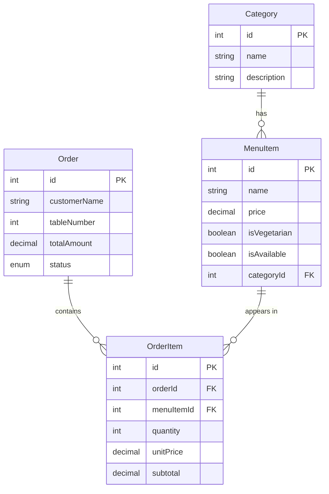

# Restaurant Digital Menu & Order Tracker

Full Stack Development mini project (TY-BCA) — **ISA-II (Backend)** + **ISA-III (Frontend)**.
Stack: **Node.js · Express · Sequelize ORM · MySQL · React (Hooks + Router) · Vite**.

## 1. Introduction
A web app where restaurant customers view a digital menu, add dishes to a cart, place an order from their table and track its status, while the restaurant staff manage the menu and orders from an admin dashboard.

## 2. Problem Statement
Paper menus and verbal orders cause mistakes, delays and no record of orders. Customers cannot see order progress, and owners cannot easily see sales.

## 3. Objectives
- Show a live menu (from MySQL) with search and category filter.
- Let customers place orders with the total calculated safely on the server.
- Let customers track an order by ID.
- Give staff an admin dashboard for orders, menu, categories and sales reports.

## 4. Scope
In scope: menu, cart, order placement, order tracking, admin CRUD, daily sales report. Out of scope: online payments, customer accounts, real-time sockets.

## 5. Features
- Menu with images, price, Veg/Non-veg label, availability, search, category filter
- Cart: add, increase/decrease, remove, automatic total
- Order form (name, table, notes) with validation; order confirmation with Order ID
- Order tracking with refresh button
- Admin: stats cards, filter orders (status/date/search), order details, update status, add/edit/delete menu items (with confirm), availability toggle, manage categories, daily sales report
- Loading spinners, error boxes, success toasts, responsive design

## 6. Technologies
Node.js, Express 4, Sequelize 6, mysql2, dotenv, cors · React 18, React Router 6, Axios, Vite 5 · MySQL 8.

## 7. System Requirements
Windows 10/11, Node.js 18 or newer (LTS), MySQL Server 8, a browser (Chrome/Edge), 4 GB RAM.

## 8. Architecture
```
Browser (React, port 5173) --Axios/JSON--> Express API (port 5000) --Sequelize--> MySQL (port 3306)
```
- **Routes** map URLs to **controllers**; controllers use **models** (Sequelize) to talk to MySQL.
- **Middleware**: admin check, error handler (turns errors into proper JSON + status codes).
- **React**: pages → components (props); shared state with Context (`CartContext` uses `useReducer`, `AuthContext`, `ToastContext`).

## 9. Database
Database name: `restaurant_order_tracker`

| Table | Columns |
|---|---|
| Categories | id, name (unique), description, createdAt, updatedAt |
| MenuItems | id, name, description, price (>0), imageUrl, isVegetarian, isAvailable, categoryId (FK), timestamps |
| Orders | id, customerName, tableNumber, notes, totalAmount, status (Pending/Preparing/Ready/Completed), timestamps |
| OrderItems | id, orderId (FK), menuItemId (FK), quantity (>=1), unitPrice, subtotal, timestamps |

Deletion rules: deleting an Order deletes its OrderItems (CASCADE). A Category with menu items, or a MenuItem used in orders, **cannot** be deleted (RESTRICT → API returns 409).
`unitPrice` is copied when the order is placed, so old orders stay correct if prices change.


Orders ↔ MenuItems is **many-to-many** through `OrderItems`.

## 10. Folder Structure
```
restaurant-digital-menu-order-tracker/
├── README.md, .gitignore
├── server/
│   ├── package.json, .env.example, .sequelizerc, API_DOCUMENTATION.md
│   ├── tests/orderUtils.test.js
│   └── src/ app.js, server.js, config/, models/, controllers/, routes/,
│            middleware/, migrations/, seeders/, utils/
└── client/
    ├── package.json, index.html, vite.config.js, .env.example
    ├── public/images/ (local SVG food pictures)
    ├── tests/cartReducer.test.js
    └── src/ main.jsx, App.jsx, api/, components/, context/, hooks/, layouts/, pages/, styles/, utils/
```

## 11. Setup on Windows (step by step)
### 11.1 Install software
1. Install **Node.js LTS** from https://nodejs.org (keep defaults). Check in a new Command Prompt:
   ```
   node -v
   npm -v
   ```
2. Install **MySQL Server 8** (MySQL Installer from https://dev.mysql.com/downloads/installer/ → "Server only"). Remember the **root password** you set. Keep "Start MySQL Server at system startup" ticked.
3. Check MySQL is running: press `Win + R` → `services.msc` → find **MySQL80** → status **Running**.

### 11.2 Backend
```
cd restaurant-digital-menu-order-tracker\server
copy .env.example .env
notepad .env
```
In `.env` set `DB_PASSWORD` to your MySQL root password and change `ADMIN_KEY` (this is the admin login password). Then:
```
npm install
npm run db:setup
npm run dev
```
`npm run db:setup` = **create database** (`db:create`) + **migrations** (`db:migrate`) + **sample data** (`db:seed`). You can also run the three commands separately. To wipe and reload demo data: `npm run db:reset`.
You should see: `MySQL connection OK.` and `API running at http://localhost:5000/api`. Test in browser: http://localhost:5000/api/menu

(Optional manual database creation in MySQL Command Line Client: `CREATE DATABASE restaurant_order_tracker;`)

### 11.3 Frontend (open a second terminal)
```
cd restaurant-digital-menu-order-tracker\client
npm install
npm run dev
```
Open **http://localhost:5173** in your browser.
Admin: http://localhost:5173/admin/login → password = `ADMIN_KEY` from `server/.env`.

If your backend uses another port, copy `client\.env.example` to `client\.env` and change `VITE_API_URL`.

## 12. API Documentation
See [`server/API_DOCUMENTATION.md`](server/API_DOCUMENTATION.md).

## 13. Testing
Automated tests (use Node's built-in test runner, no extra packages):
```
cd server && npm test      (order validation + total calculation)
cd client && npm test      (cart reducer: add, +/-, remove, total)
```
Manual test checklist (needs MySQL running): menu loads → search "chicken" → filter by category → add items, change quantities → checkout → note Order ID → track it → log in to admin → change status → refresh tracking page → add/edit/delete a menu item → open Dashboard and pick a date in the report. Try invalid inputs (empty name, table 0) to see validation messages. Try ordering "Goan Fish Curry" (unavailable) — it is blocked.

## 14. Common Errors and Solutions
| Error | Fix |
|---|---|
| `ER_ACCESS_DENIED_ERROR` / Access denied for user 'root' | Wrong `DB_PASSWORD` in `server/.env`. |
| `ECONNREFUSED 127.0.0.1:3306` | MySQL is not running. Start **MySQL80** in `services.msc`. |
| `ER_BAD_DB_ERROR: Unknown database` | Run `npm run db:create` (or `npm run db:setup`). |
| `Client does not support authentication protocol` | Use mysql2 (already installed) — if it persists run in MySQL: `ALTER USER 'root'@'localhost' IDENTIFIED WITH mysql_native_password BY 'yourpassword';` |
| `Table ... doesn't exist` | Run `npm run db:migrate`. |
| Browser shows "Cannot reach the server" | Backend not running, or port differs from `VITE_API_URL`. |
| CORS error in console | `CLIENT_URL` in `server/.env` must be `http://localhost:5173` — restart backend after editing. |
| `Port 5000 already in use` | Change `PORT` in `.env` and `VITE_API_URL` in `client/.env`. |
| `'npm' is not recognized` | Reinstall Node.js, then open a **new** terminal. |
| Admin login says wrong password | Use the exact `ADMIN_KEY` from `server/.env` (restart backend after changes). |

## 15. Limitations
- **Admin login is a demo workflow:** one shared password (`ADMIN_KEY`) kept in `.env` (never in the database or code), sent in a header and kept in the browser's `sessionStorage`. There are no user accounts, hashing, tokens or HTTPS. Not suitable for production.
- Anyone who knows an order ID can view that order (IDs are sequential).
- No online payments; no real-time updates (use the Refresh button).
- Images are local SVG illustrations; the admin enters image URLs/paths manually (no upload).
- Test coverage: unit tests for the order logic and cart logic only; no database integration tests.

## 16. Future Enhancements
Real admin accounts (bcrypt + JWT), image upload, live updates with WebSockets, payments, kitchen display screen, order cancellation, pagination.

## 17. Conclusion
The project meets the ISA-II and ISA-III requirements: a relational MySQL backend with Sequelize and a React frontend that reads and writes real data end-to-end.

---
## Requirements Checklist
| Requirement | Where |
|---|---|
| MySQL connection with Sequelize (ISA-II) | `server/src/config/database.js`, `server.js` |
| Models with validations/constraints | `server/src/models/*.js` |
| 1:M and M:N associations | `server/src/models/index.js` |
| CRUD with Sequelize finders | `server/src/controllers/` (`findAll`, `findByPk`, `create`, `update`, `destroy`) |
| Raw SQL / advanced filtering | `dashboardController.getDailySales`, filters in `menuController`/`orderController` |
| config/models/routes/controllers folders | `server/src/` |
| Migration + seed | `server/src/migrations/`, `server/src/seeders/` |
| API docs | `server/API_DOCUMENTATION.md` |
| Reusable components + props | `client/src/components/` |
| useState / useEffect | pages and `hooks/useFetch.js` |
| useContext / useReducer | `context/CartContext.jsx` (+ `cartReducer.js`), `AuthContext`, `ToastContext` |
| React Router multi-page | `client/src/App.jsx` |
| useRef / useMemo / useCallback | `SearchBar`, `Menu.jsx`, `useFetch.js`, contexts |
| React ↔ API with real DB data | `client/src/api/client.js`, all pages |

---
## Viva Preparation (simple answers)
- **Node.js** – lets us run JavaScript on the server (outside the browser).
- **Express** – a Node framework that makes it easy to create routes and APIs.
- **React** – a JavaScript library to build UIs from small reusable components.
- **Sequelize** – an ORM: we use JavaScript objects (models) instead of writing SQL for every operation.
- **MySQL** – the relational database that stores our tables permanently.
- **CRUD** – Create, Read, Update, Delete. Example: `POST/GET/PUT/DELETE /api/menu`.
- **REST API** – URLs + HTTP methods (GET, POST, PUT, PATCH, DELETE) that send/receive JSON, with status codes like 200, 201, 400, 404.
- **Associations** – relationships between tables. `Category hasMany MenuItem` (1:M). Orders and MenuItems are **many-to-many** through the `OrderItems` junction table.
- **Why store unitPrice?** So old orders do not change when menu prices change.
- **Why calculate the total on the server?** The browser can be tampered with; the server uses real database prices.
- **Transaction** – saves the order and all its items together; if one step fails everything is rolled back.
- **Migration / seeder** – migration creates tables; seeder inserts sample data.
- **React hooks** – `useState` (local data), `useEffect` (run code like API calls after render), `useRef` (reference a DOM element, e.g. focus the search box), `useMemo` (remember a calculated value, e.g. grouped menu), `useCallback` (remember a function).
- **useContext / useReducer** – Context shares data (cart) with any component without passing props through every level; `useReducer` updates complex state through actions (ADD, INCREASE, DECREASE, REMOVE, CLEAR).
- **API integration** – Axios sends requests to Express inside `useEffect`/event handlers; the response is stored in state and the UI re-renders.
- **Advanced query** – `/api/reports/daily-sales` uses parameterized raw SQL with `COUNT`, `SUM`, `GROUP BY`, `JOIN` and a 7-day range. `:date` is a replacement parameter, which prevents SQL injection.
